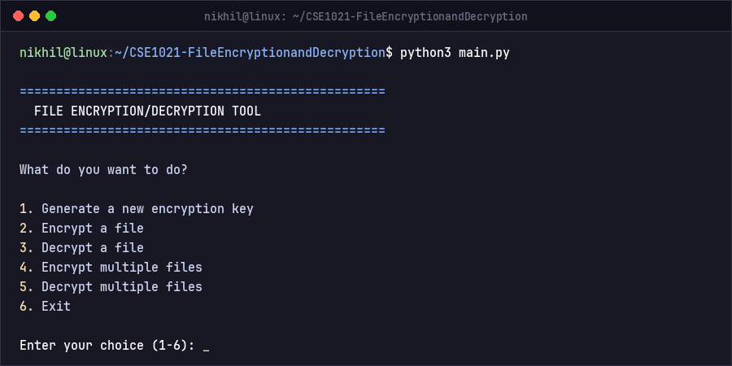
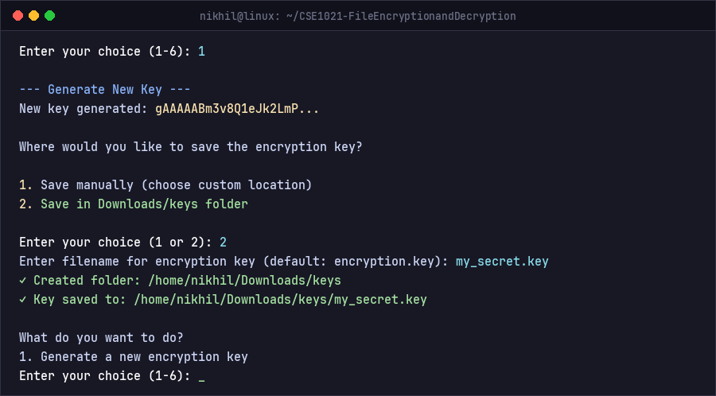
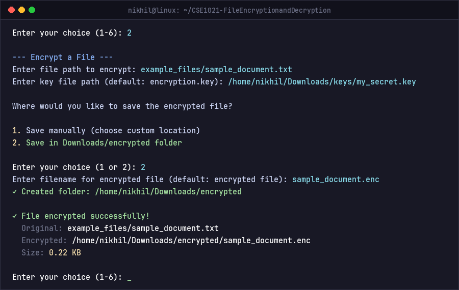
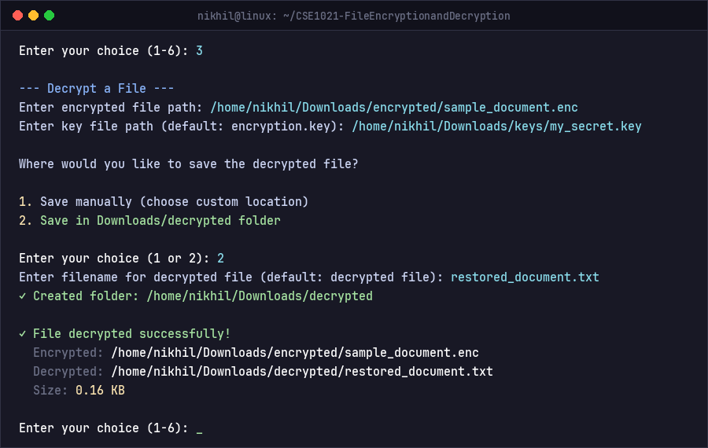
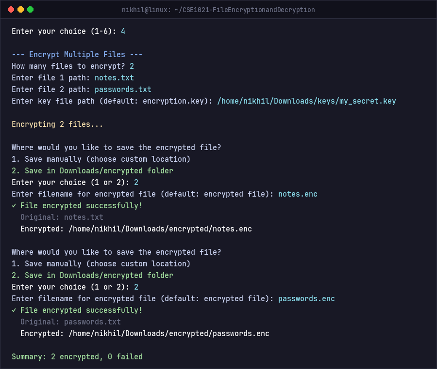
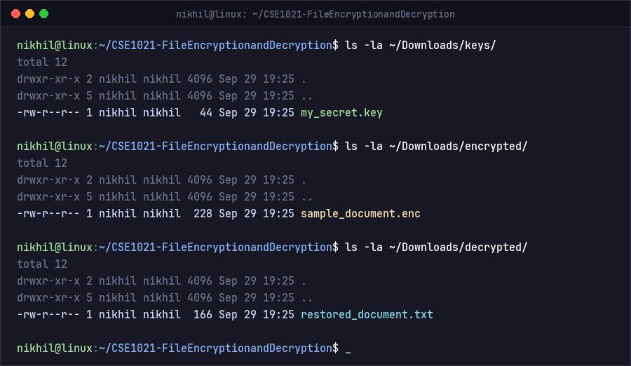

# Screenshots & Demo Runs 📸

Here are actual screenshots of the File Encryption & Decryption tool running in the terminal.

---

### 1. Main Application Menu
When you run `python3 main.py`, you get this clean menu:

---

### 2. Generating a Key
Option 1 creates an AES key and lets you save it straight to `Downloads/keys`:

---

### 3. Encrypting a File
Option 2 encrypts your file and saves it into `Downloads/encrypted`:

---

### 4. Decrypting a File
Option 3 restores your encrypted file and puts it inside `Downloads/decrypted`:

---

### 5. Batch Operations (Multiple Files)
Option 4 lets you encrypt multiple files one after another:

---

### 6. Folder Organization in Downloads
Everything is neatly organized in `~/Downloads/keys/`, `~/Downloads/encrypted/`, and `~/Downloads/decrypted/`:

